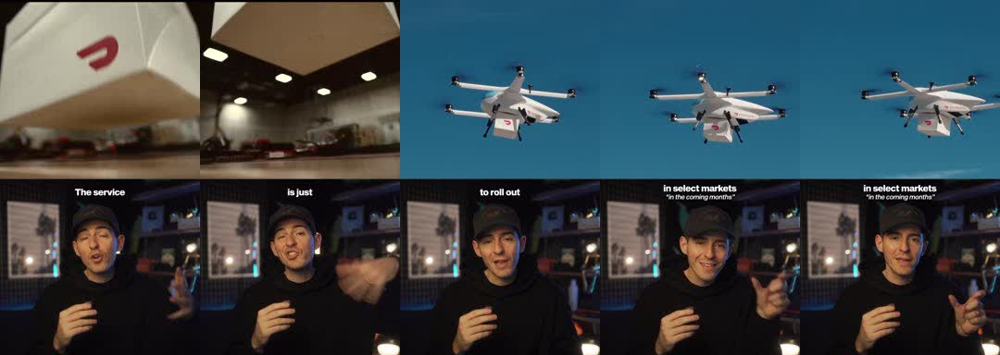

# v11_s13 · split_broll · 28.6–31.2s (calidad 4)

- **Guion:** service is just starting to roll out in select markets with
- **Qué se ve:** Arriba caja con logo bajo el dron (macro) y dron en cielo azul; subtítulo 'in select markets' con una segunda línea pequeña en itálica '“in the coming months”'.
- **Diseño:** Split 50/50. Subtítulo de DOS líneas: 'in select markets' (sans bold blanca ≈30 px) + debajo '“in the coming months”' en itálica blanca más pequeña (≈18 px) entre comillas: nota de precisión/descargo.
- **Efectos:** Sin grano, papel ni halftone añadidos. A-roll: set oscuro, viñeta natural, prácticos cálidos y tubo/luz cian al fondo. Mitad superior sin filtros: el material conserva su color original (contraste fuerte con el set oscuro de abajo).
- **Animación:** La mitad superior entra por corte seco (1 fotograma) sincronizada con la palabra; los cambios internos también son cortes secos; el único movimiento es el propio del material (cámara del clip, scroll o zoom lento). La mitad inferior no corta (toma continua). Subtítulo por sustitución instantánea cada 1–3 palabras.
- **Por qué aquí:** Matiza la promesa ('just starting to roll out'): añade letra pequeña honesta sin cortar el ritmo.
