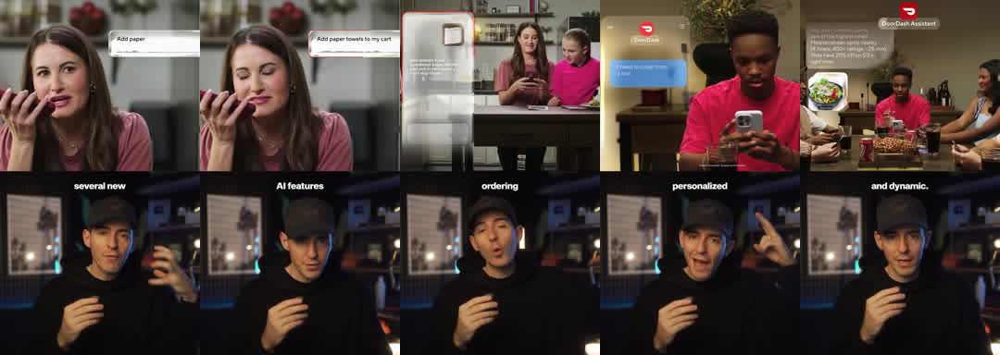

# v11_s18 · split_broll · 39.8–44.5s (calidad 3)

- **Guion:** new AI features that makes ordering way more personalized and dynamic.
- **Qué se ve:** Arriba 4 demos de funciones IA (films de producto con UI superpuesta): mujer comiendo con burbuja 'Add paper towels to my cart', madre e hija escaneando una lista escrita a mano, chico con móvil y burbujas de chat, grupo a la mesa con tarjeta 'DoorDash Assistant'.
- **Diseño:** Split 48/52: vídeo real a sangre arriba (recorte horizontal ≈9:8), él abajo en plano medio sobre set oscuro con luces cálidas/cian. Subtítulo: sans geométrica bold blanca, minúsculas con puntuación, ≈30 px de alto de letra sobre 720 px de ancho, centrado en x, 1–3 palabras, bajo la costura (y≈54 %), sin caja.
- **Efectos:** Sin grano, papel ni halftone añadidos. A-roll: set oscuro, viñeta natural, prácticos cálidos y tubo/luz cian al fondo. Mitad superior sin filtros: el material conserva su color original (contraste fuerte con el set oscuro de abajo).
- **Animación:** La mitad superior entra por corte seco (1 fotograma) sincronizada con la palabra; los cambios internos también son cortes secos; el único movimiento es el propio del material (cámara del clip, scroll o zoom lento). La mitad inferior no corta (toma continua). Subtítulo por sustitución instantánea cada 1–3 palabras.
- **Por qué aquí:** 'several new AI features… personalized and dynamic': una demo por adjetivo; la costura sube a ≈48 % porque el material es más panorámico.
