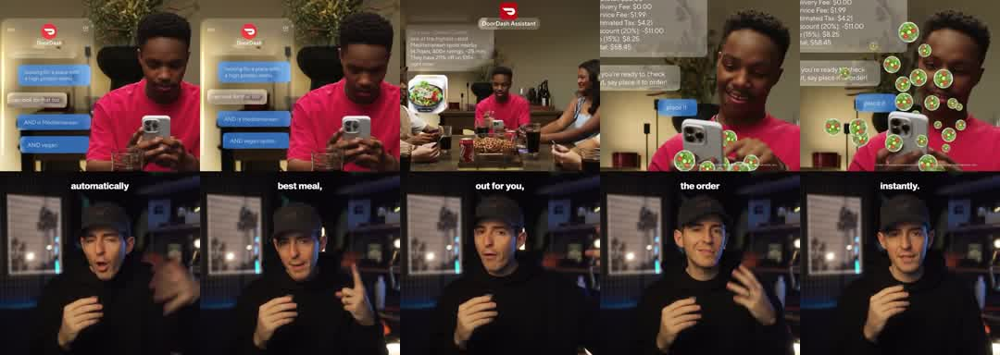

# v11_s24 · split_broll · 66.6–71.2s (calidad 3)

- **Guion:** It can automatically find the best meal, list it out for you and then place the order instantly.
- **Qué se ve:** Arriba 3 demos: chico con burbujas de filtros ('looking for a place with… AND is Mediterranean'), grupo a la mesa con tarjeta del asistente, chico sonriendo con resumen de pedido, botón 'place it' y lluvia de emojis verdes.
- **Diseño:** Split 48/52: vídeo real a sangre arriba (recorte horizontal ≈9:8), él abajo en plano medio sobre set oscuro con luces cálidas/cian. Subtítulo: sans geométrica bold blanca, minúsculas con puntuación, ≈30 px de alto de letra sobre 720 px de ancho, centrado en x, 1–3 palabras, bajo la costura (y≈54 %), sin caja.
- **Efectos:** Sin grano, papel ni halftone añadidos. A-roll: set oscuro, viñeta natural, prácticos cálidos y tubo/luz cian al fondo. Mitad superior sin filtros: el material conserva su color original (contraste fuerte con el set oscuro de abajo).
- **Animación:** La mitad superior entra por corte seco (1 fotograma) sincronizada con la palabra; los cambios internos también son cortes secos; el único movimiento es el propio del material (cámara del clip, scroll o zoom lento). La mitad inferior no corta (toma continua). Subtítulo por sustitución instantánea cada 1–3 palabras.
- **Por qué aquí:** 'find the best meal, list it out, place the order instantly': 3 verbos = 3 demos; la lluvia de emojis marca el 'instantly'.
