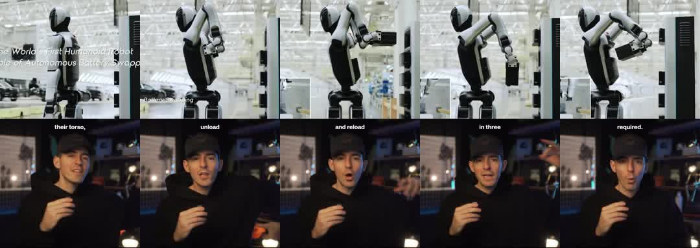

# v12_s24 · split_broll · 46.5–54.5s (calidad 5)

- **Guion:** twist their torso, unload the dead battery and reload for themselves. A complete battery upgrade in three minutes, no human required.
- **Qué se ve:** Arriba UN plano continuo de 8.1 s: el robot ante la estación de carga gira el torso, saca la batería gastada con el brazo, la deja y coge otra. El material trae un rótulo propio 'The World's First Humanoid Robot Capable of Autonomous Battery Swapping' (itálica con contorno) los primeros 2 s.
- **Diseño:** Split 48/52: vídeo real a sangre arriba (recorte horizontal ≈9:8), él abajo en plano medio sobre set oscuro con luces cálidas/cian. Subtítulo: sans geométrica bold blanca, minúsculas con puntuación, ≈30 px de alto de letra sobre 720 px de ancho, centrado en x, 1–3 palabras, bajo la costura (y≈51 %), sin caja.
- **Efectos:** Sin grano, papel ni halftone añadidos. A-roll: set oscuro, viñeta natural, prácticos cálidos y tubo/luz cian al fondo. Mitad superior sin filtros: el material conserva su color original (contraste fuerte con el set oscuro de abajo).
- **Animación:** Entra por corte seco y NO corta en 8.1 s (46.46–54.55): la acción real marca el ritmo; el subtítulo va narrando cada paso ('twist / their torso, / unload / battery, / and reload / for themselves / a complete / battery upgrade / in three / minutes. / No human / required.'). Sale por corte seco a cara.
- **Por qué aquí:** La prueba central del vídeo se deja entera: cada verbo del guion coincide con el gesto del robot; cortar le quitaría credibilidad.
