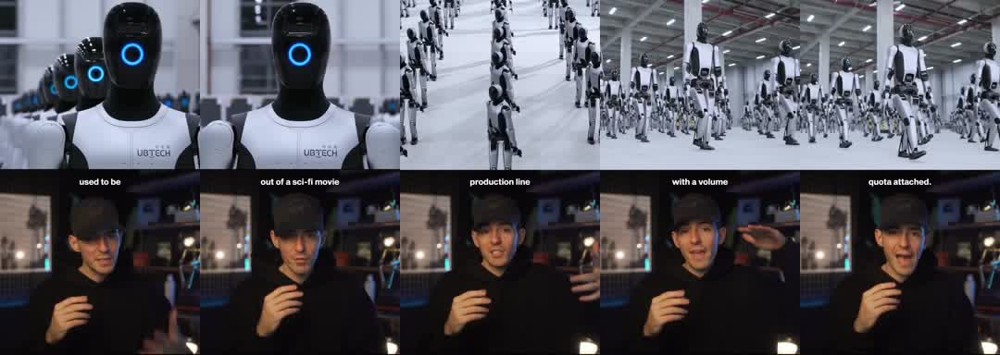

# v12_s28 · split_broll · 63.2–70.3s (calidad 3)

- **Guion:** to be something out of a sci-fi movie. But now it's a literal production line working in China with a volume quota attached.
- **Qué se ve:** Arriba robots con anillo azul (zoom-in), cuadrícula aérea, fila lateral con un robot levantando el brazo y masa caminando.
- **Diseño:** Split 48/52: vídeo real a sangre arriba (recorte horizontal ≈9:8), él abajo en plano medio sobre set oscuro con luces cálidas/cian. Subtítulo: sans geométrica bold blanca, minúsculas con puntuación, ≈30 px de alto de letra sobre 720 px de ancho, centrado en x, 1–3 palabras, bajo la costura (y≈51 %), sin caja.
- **Efectos:** Sin grano, papel ni halftone añadidos. A-roll: set oscuro, viñeta natural, prácticos cálidos y tubo/luz cian al fondo. Mitad superior sin filtros: el material conserva su color original (contraste fuerte con el set oscuro de abajo).
- **Animación:** La mitad superior entra por corte seco (1 fotograma) sincronizada con la palabra; los cambios internos también son cortes secos; el único movimiento es el propio del material (cámara del clip, scroll o zoom lento). La mitad inferior no corta (toma continua). Subtítulo por sustitución instantánea cada 1–3 palabras.
- **Por qué aquí:** 'something out of a sci-fi movie… now a literal production line': imágenes más cinematográficas del lote.
