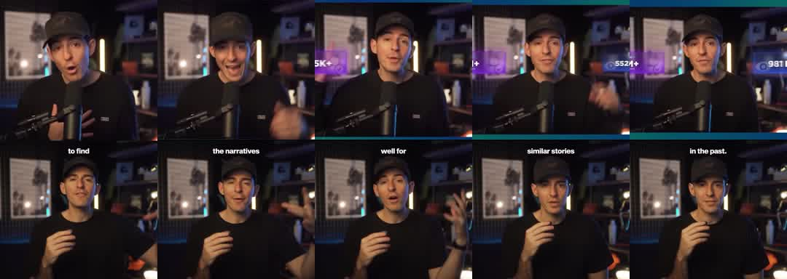

# v13_s23 · split_broll · 42.4–46.0s (calidad 4)

- **Guion:** find the narratives that have worked well for similar stories in the past.
- **Qué se ve:** Arriba clip de uno de sus videos de YouTube: él hablando a un micrófono de podcast con contadores morados animados («5K+», «936K+», «981K+»). Abajo él. Subtítulos «to find», «the narratives», «that have worked», «well for», «similar stories», «in the past.».
- **Diseño:** Pantalla dividida: evidencia arriba (0–50 %), él abajo en set oscuro (gorra y camiseta negras, luces naranja/cian desenfocadas). Costura recta sin borde en y≈645 px de 1280 (50,4 %). Subtítulo: sans geométrica bold blanca (tipo Inter/Helvetica Now Bold), minúsculas con mayúscula inicial de frase, ~30 px de alto de fuente sobre 720 px de ancho, 1–3 palabras, centrado en x, sombra negra suave. Subtítulo en y≈693 px (54 %), justo bajo la costura, sobre su gorra. Arriba: video real recortado a 720×645.
- **Efectos:** Grado natural del clip, sin filtro común.
- **Animación:** Movimiento propio del clip (cámara en mano / travelling); corte seco.
- **Por qué aquí:** «mi mejor contenido en YouTube» → un video suyo con el contador de vistas subiendo: prueba social.
