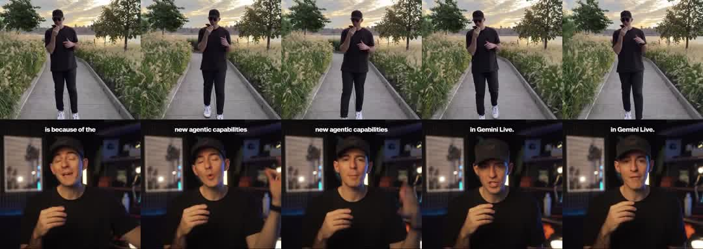

# v13_s42 · split_broll · 89.0–92.2s (calidad 3)

- **Guion:** is because of the new agenda capabilities in Gemini Live.
- **Qué se ve:** Arriba b-roll de él caminando hacia cámara por un sendero con hierba alta, móvil en la boca. Abajo él. Subtítulos «is because of the», «new agentic capabilities», «in Gemini Live.».
- **Diseño:** Pantalla dividida: evidencia arriba (0–50 %), él abajo en set oscuro (gorra y camiseta negras, luces naranja/cian desenfocadas). Costura recta sin borde en y≈645 px de 1280 (50,4 %). Subtítulo: sans geométrica bold blanca (tipo Inter/Helvetica Now Bold), minúsculas con mayúscula inicial de frase, ~30 px de alto de fuente sobre 720 px de ancho, 1–3 palabras, centrado en x, sombra negra suave. Subtítulo en y≈693 px (54 %), justo bajo la costura, sobre su gorra. Arriba: video real recortado a 720×645.
- **Efectos:** Grado natural del clip, sin filtro común.
- **Animación:** Movimiento propio del clip (cámara en mano / travelling); corte seco.
- **Por qué aquí:** Refuerza la idea de 'hablar en vez de teclear' con imagen ya vista.
