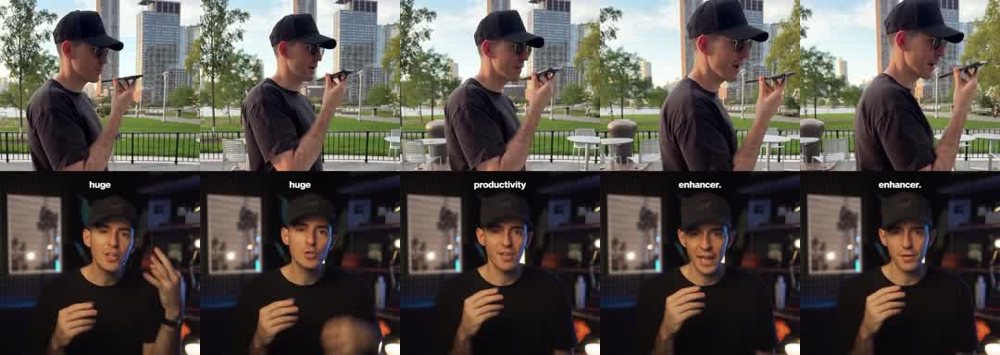

# v13_s51 · split_broll · 111.7–113.4s (calidad 3)

- **Guion:** a huge productivity enhancer.
- **Qué se ve:** Arriba b-roll de él con gafas de sol hablando al móvil en el parque con edificios. Abajo él. Subtítulos «huge», «productivity», «enhancer.».
- **Diseño:** Pantalla dividida: evidencia arriba (0–50 %), él abajo en set oscuro (gorra y camiseta negras, luces naranja/cian desenfocadas). Costura recta sin borde en y≈645 px de 1280 (50,4 %). Subtítulo: sans geométrica bold blanca (tipo Inter/Helvetica Now Bold), minúsculas con mayúscula inicial de frase, ~30 px de alto de fuente sobre 720 px de ancho, 1–3 palabras, centrado en x, sombra negra suave. Subtítulo en y≈693 px (54 %), justo bajo la costura, sobre su gorra. Arriba: video real recortado a 720×645.
- **Efectos:** Grado natural del clip, sin filtro común.
- **Animación:** Movimiento propio del clip (cámara en mano / travelling); corte seco.
- **Por qué aquí:** Imagen de uso real para el veredicto final.
