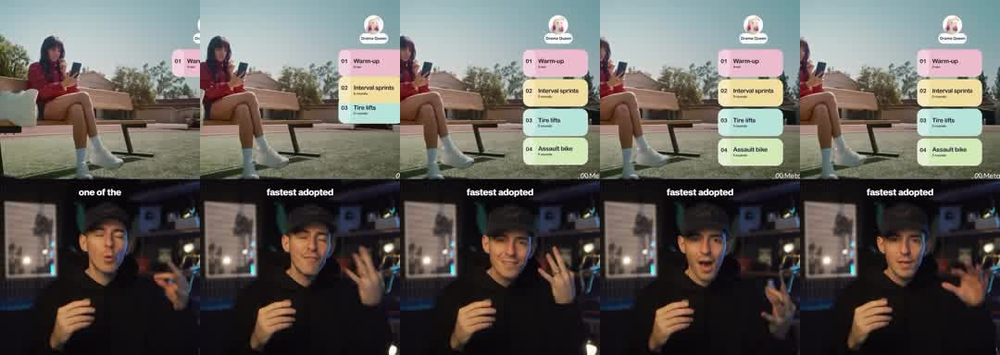

# v14_s22 · split_broll · 30.9–32.8s (calidad 3)

- **Guion:** one of the fastest adopted AI
- **Qué se ve:** Arriba una mujer con chaqueta roja sentada en un banco con el móvil; al lado, tarjetas pastel de una rutina (01 Warm-up, 02 Interval sprints, 03 Tire lifts, 04 Assault bike). Subtítulos «one of the», «fastest adopted».
- **Diseño:** Pantalla dividida: evidencia arriba, él abajo en set oscuro (gorra y sudadera con capucha negras, bokeh cálido y cian). Costura recta sin borde en y=646 px de 1280 (50,5 %). Subtítulo: sans bold blanca (tipo Inter/Helvetica Now Bold) ~30 px de alto de fuente sobre 720 px de ancho, 1–3 palabras, centrado en x, sombra negra suave. Subtítulo en y≈693 px (54 %), justo bajo la costura. Arriba: video real del evento/producto recortado a 720×646.
- **Efectos:** Grado propio de cada clip (keynote azul cielo, producto en beige, cine oscuro).
- **Animación:** Movimiento propio del clip; entra y sale por corte seco, sin reencuadre animado.
- **Por qué aquí:** Uso cotidiano del asistente.
