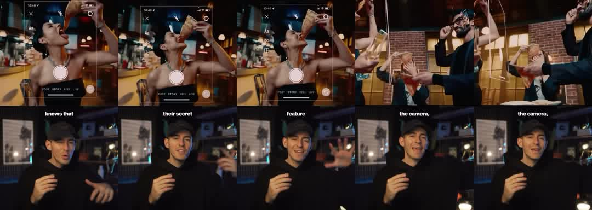

# v14_s42 · split_broll · 73.4–75.7s (calidad 3)

- **Guion:** that their secret feature isn't the camera,
- **Qué se ve:** Arriba interfaz de cámara de historias sobre una mujer bebiendo en un bar (73,42–74,67) y luego un brindis en grupo (74,67–75,67). Subtítulos «knows that», «their secret», «feature», «isn't», «the camera,».
- **Diseño:** Pantalla dividida: evidencia arriba, él abajo en set oscuro (gorra y sudadera con capucha negras, bokeh cálido y cian). Costura recta sin borde en y=646 px de 1280 (50,5 %). Subtítulo: sans bold blanca (tipo Inter/Helvetica Now Bold) ~30 px de alto de fuente sobre 720 px de ancho, 1–3 palabras, centrado en x, sombra negra suave. Subtítulo en y≈693 px (54 %), justo bajo la costura. Arriba: video real del evento/producto recortado a 720×646.
- **Efectos:** Grado propio de cada clip (keynote azul cielo, producto en beige, cine oscuro).
- **Animación:** Movimiento propio del clip; entra y sale por corte seco, sin reencuadre animado.
- **Por qué aquí:** «no es la cámara» → muestra la cámara para negarla después.
