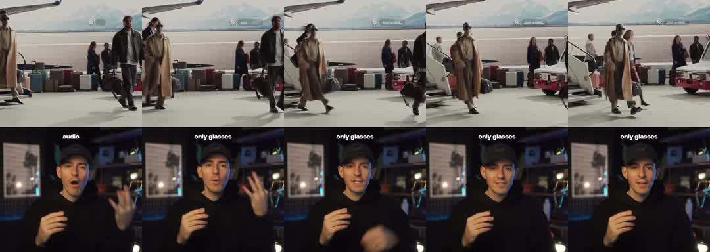

# v14_s46 · split_broll · 79.2–80.6s (calidad 2)

- **Guion:** audio only glasses that
- **Qué se ve:** Arriba personas con abrigos caminando por una pista con maletas y un coche. Subtítulos «audio», «only glasses».
- **Diseño:** Pantalla dividida: evidencia arriba, él abajo en set oscuro (gorra y sudadera con capucha negras, bokeh cálido y cian). Costura recta sin borde en y=646 px de 1280 (50,5 %). Subtítulo: sans bold blanca (tipo Inter/Helvetica Now Bold) ~30 px de alto de fuente sobre 720 px de ancho, 1–3 palabras, centrado en x, sombra negra suave. Subtítulo en y≈693 px (54 %), justo bajo la costura. Arriba: video real del evento/producto recortado a 720×646.
- **Efectos:** Grado propio de cada clip (keynote azul cielo, producto en beige, cine oscuro).
- **Animación:** Movimiento propio del clip; entra y sale por corte seco, sin reencuadre animado.
- **Por qué aquí:** Estilo de vida.
