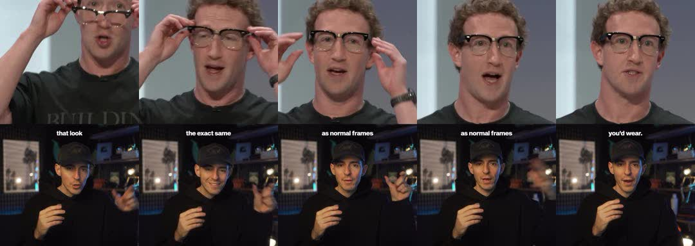

# v14_s47 · split_broll · 80.6–83.3s (calidad 3)

- **Guion:** look the exact same as normal frames you'd wear.
- **Qué se ve:** Arriba primer plano del presentador poniéndose unas gafas de montura negra. Subtítulos «that look», «the exact same», «as normal frames», «you'd wear.».
- **Diseño:** Pantalla dividida: evidencia arriba, él abajo en set oscuro (gorra y sudadera con capucha negras, bokeh cálido y cian). Costura recta sin borde en y=646 px de 1280 (50,5 %). Subtítulo: sans bold blanca (tipo Inter/Helvetica Now Bold) ~30 px de alto de fuente sobre 720 px de ancho, 1–3 palabras, centrado en x, sombra negra suave. Subtítulo en y≈693 px (54 %), justo bajo la costura. Arriba: video real del evento/producto recortado a 720×646.
- **Efectos:** Grado propio de cada clip (keynote azul cielo, producto en beige, cine oscuro).
- **Animación:** Movimiento propio del clip; entra y sale por corte seco, sin reencuadre animado.
- **Por qué aquí:** «igual que unas gafas normales» → gafas normales en una cara.
