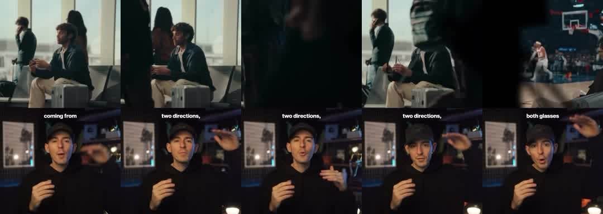

# v14_s61 · split_broll · 106.1–107.8s (calidad 4)

- **Guion:** from two directions. Both
- **Qué se ve:** Arriba un hombre sentado en una sala de espera con gafas; la imagen se oscurece hasta negro y desde la oscuridad se abre (máscara irregular) a un partido de baloncesto. Subtítulos «coming from», «two directions,».
- **Diseño:** Pantalla dividida: evidencia arriba, él abajo en set oscuro (gorra y sudadera con capucha negras, bokeh cálido y cian). Costura recta sin borde en y=646 px de 1280 (50,5 %). Subtítulo: sans bold blanca (tipo Inter/Helvetica Now Bold) ~30 px de alto de fuente sobre 720 px de ancho, 1–3 palabras, centrado en x, sombra negra suave. Subtítulo en y≈693 px (54 %), justo bajo la costura. Arriba: video real del evento/producto recortado a 720×646.
- **Efectos:** Grado propio de cada clip (keynote azul cielo, producto en beige, cine oscuro).
- **Animación:** Movimiento propio del clip; entra y sale por corte seco, sin reencuadre animado.
- **Por qué aquí:** «dos direcciones» → transición de un mundo a otro dentro del propio clip.
