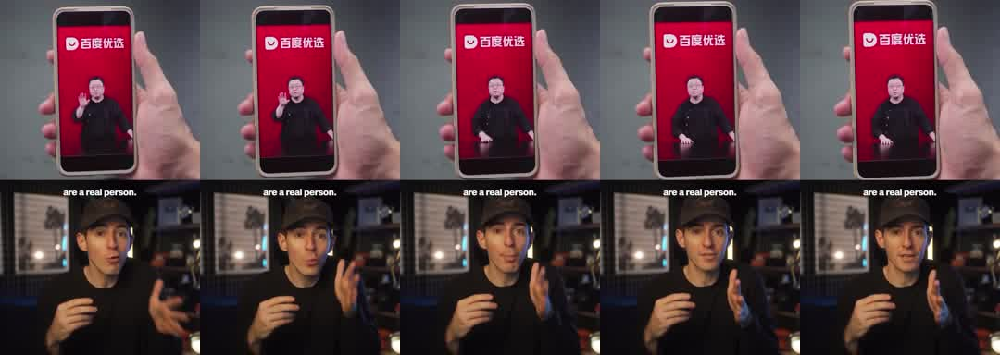

# v15_s06 · split_broll · 5.9–7.0s (calidad 4)

- **Guion:** a real person.
- **Qué se ve:** Arriba una mano sosteniendo un móvil cuya pantalla muestra al presentador en la app «百度优选» sobre fondo gris. Subtítulo «are a real person.».
- **Diseño:** Pantalla dividida: evidencia arriba, él abajo en set oscuro (gorra y camiseta negras, tubo de luz cálida a la derecha). Costura recta sin borde en y=649 px de 1280 (50,7 %). Subtítulo: sans bold blanca (tipo Inter/Helvetica Now Bold) ~30 px de alto de fuente sobre 720 px de ancho, 1–3 palabras, centrado en x, sombra negra suave. Subtítulo en y≈693 px (54 %), justo bajo la costura. Arriba: clip del directo chino (fondo rojo saturado, dos presentadores tras una mesa, interfaz de venta en chino) recortado a 720×649.
- **Efectos:** Rojo saturado del propio directo; sin filtro añadido.
- **Animación:** Movimiento propio del clip; entra y sale por corte seco.
- **Por qué aquí:** «no son personas reales» → los encierra en una pantalla: son software.
