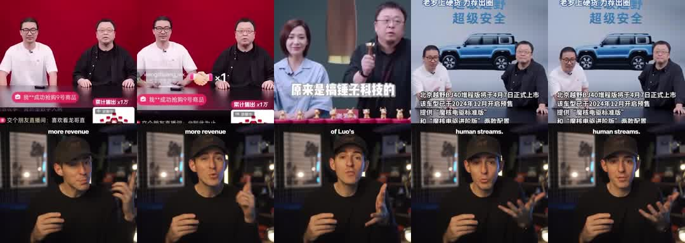

# v15_s43 · split_broll · 59.8–62.5s (calidad 3)

- **Guion:** That's more revenue than most of Luo's human streams.
- **Qué se ve:** Arriba 3 clips: (59,81) el directo de IA; (60,64) el presentador con una copresentadora y rótulos chinos; (61,65) presentadores con el todoterreno azul. Subtítulos «That's», «more revenue», «than most», «of Luo's», «human streams.».
- **Diseño:** Pantalla dividida: evidencia arriba, él abajo en set oscuro (gorra y camiseta negras, tubo de luz cálida a la derecha). Costura recta sin borde en y=649 px de 1280 (50,7 %). Subtítulo: sans bold blanca (tipo Inter/Helvetica Now Bold) ~30 px de alto de fuente sobre 720 px de ancho, 1–3 palabras, centrado en x, sombra negra suave. Subtítulo en y≈693 px (54 %), justo bajo la costura. Arriba: clip del directo chino (fondo rojo saturado, dos presentadores tras una mesa, interfaz de venta en chino) recortado a 720×649.
- **Efectos:** Rojo saturado del propio directo; sin filtro añadido.
- **Animación:** Movimiento propio del clip; entra y sale por corte seco.
- **Por qué aquí:** Comparación con sus directos humanos → clips de directos antiguos.
