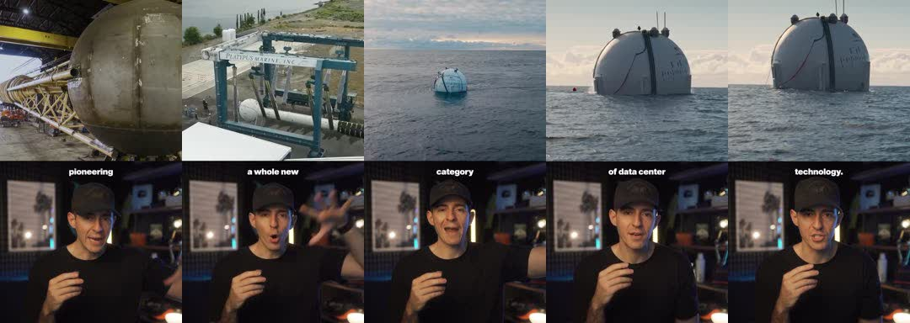

# v16_s04 · split_broll · 5.3–8.7s (calidad 3)

- **Guion:** pioneering a whole new category of data center technology.
- **Qué se ve:** Arriba 4 clips: esfera metálica en fábrica junto a una grúa (5,27), astillero con grúa pórtico azul y un tubo blanco (5,93), boya en mar abierto con cielo nublado (6,73), cúpula de cerca (7,30). Subtítulos «pioneering», «a whole new», «category», «of data center», «technology.».
- **Diseño:** Pantalla dividida: evidencia arriba, él abajo en set oscuro (gorra y camiseta negras, tubo de luz cálida a la derecha, luz cian a la izquierda). Costura recta sin borde en y≈639 px de 1280 (49,9 %). Subtítulo: sans bold blanca (tipo Inter/Helvetica Now Bold) ~30 px de alto de fuente sobre 720 px de ancho, 1–3 palabras, centrado en x, sombra negra suave. Subtítulo en y≈680 px (53 %), justo bajo la costura. Arriba: video real (boya-centro de datos en el mar, fábrica, océano) recortado a 720×639.
- **Efectos:** Grado natural de cada clip (azules marinos, gris nublado).
- **Animación:** Movimiento propio del clip (dron, travelling); entra y sale por corte seco.
- **Por qué aquí:** Construcción → despliegue: ordena los clips como proceso.
