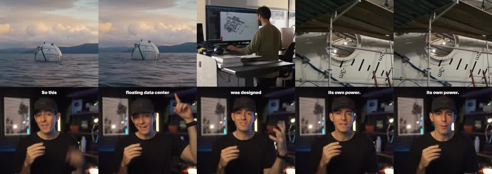

# v16_s18 · split_broll · 30.3–33.1s (calidad 3)

- **Guion:** So this floating data center was designed to make its own power.
- **Qué se ve:** Arriba 3 clips: boya en el mar con nubes (30,30), ingeniero ante un monitor con planos (31,40), interior de estructura con escala métrica pintada «2m 3m» (32,03). Subtítulos «floating data center», «was designed», «to make», «its own power.».
- **Diseño:** Pantalla dividida: evidencia arriba, él abajo en set oscuro (gorra y camiseta negras, tubo de luz cálida a la derecha, luz cian a la izquierda). Costura recta sin borde en y≈639 px de 1280 (49,9 %). Subtítulo: sans bold blanca (tipo Inter/Helvetica Now Bold) ~30 px de alto de fuente sobre 720 px de ancho, 1–3 palabras, centrado en x, sombra negra suave. Subtítulo en y≈680 px (53 %), justo bajo la costura. Arriba: video real (boya-centro de datos en el mar, fábrica, océano) recortado a 720×639.
- **Efectos:** Grado natural de cada clip (azules marinos, gris nublado).
- **Animación:** Movimiento propio del clip (dron, travelling); entra y sale por corte seco.
- **Por qué aquí:** «fue diseñado» → persona diseñando.
