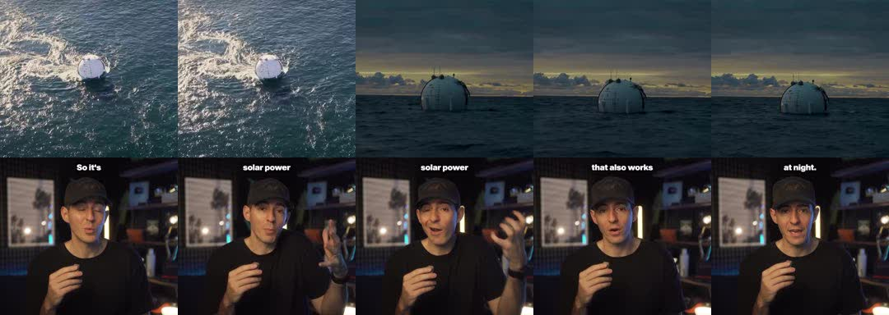

# v16_s40 · split_broll · 72.6–75.0s (calidad 4)

- **Guion:** So it's solar power that also works at night.
- **Qué se ve:** Arriba boya con estela vista desde dron (72,63) y boya al anochecer (73,67). Subtítulos «So it's», «solar power», «that also works», «at night.».
- **Diseño:** Pantalla dividida: evidencia arriba, él abajo en set oscuro (gorra y camiseta negras, tubo de luz cálida a la derecha, luz cian a la izquierda). Costura recta sin borde en y≈639 px de 1280 (49,9 %). Subtítulo: sans bold blanca (tipo Inter/Helvetica Now Bold) ~30 px de alto de fuente sobre 720 px de ancho, 1–3 palabras, centrado en x, sombra negra suave. Subtítulo en y≈680 px (53 %), justo bajo la costura. Arriba: video real (boya-centro de datos en el mar, fábrica, océano) recortado a 720×639.
- **Efectos:** Grado natural de cada clip (azules marinos, gris nublado).
- **Animación:** Movimiento propio del clip (dron, travelling); entra y sale por corte seco.
- **Por qué aquí:** «funciona de noche» → clip nocturno.
