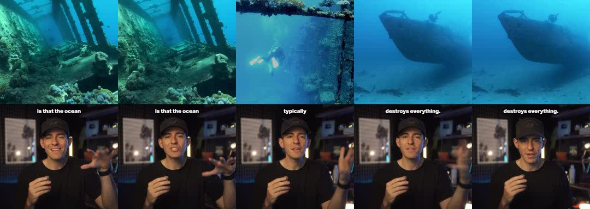

# v16_s48 · split_broll · 90.6–92.9s (calidad 4)

- **Guion:** that the ocean typically destroys everything.
- **Qué se ve:** Arriba 3 clips submarinos: restos de un naufragio con coral (90,63), buzo junto a una estructura (91,37), casco de barco hundido (92,07). Subtítulos «is that the ocean», «typically», «destroys everything.».
- **Diseño:** Pantalla dividida: evidencia arriba, él abajo en set oscuro (gorra y camiseta negras, tubo de luz cálida a la derecha, luz cian a la izquierda). Costura recta sin borde en y≈639 px de 1280 (49,9 %). Subtítulo: sans bold blanca (tipo Inter/Helvetica Now Bold) ~30 px de alto de fuente sobre 720 px de ancho, 1–3 palabras, centrado en x, sombra negra suave. Subtítulo en y≈680 px (53 %), justo bajo la costura. Arriba: video real (boya-centro de datos en el mar, fábrica, océano) recortado a 720×639.
- **Efectos:** Grado natural de cada clip (azules marinos, gris nublado).
- **Animación:** Movimiento propio del clip (dron, travelling); entra y sale por corte seco.
- **Por qué aquí:** «el océano lo destruye todo» → naufragios.
