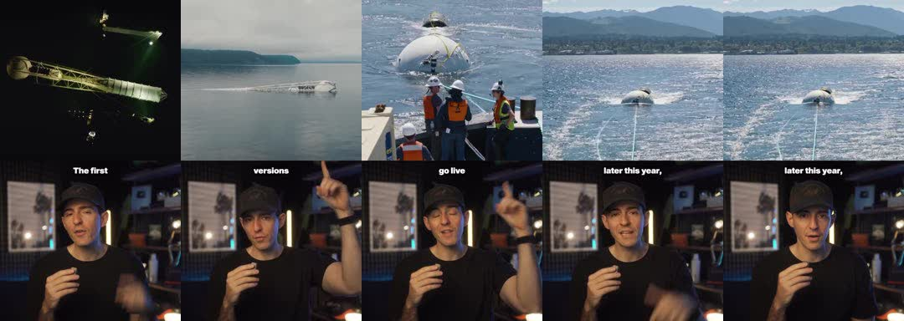

# v16_s53 · split_broll · 102.2–105.3s (calidad 4)

- **Guion:** The first full -size versions of this go live in the ocean later this year.
- **Qué se ve:** Arriba 4 clips: tubo de celosía iluminado de noche colgando de una grúa (102,17), estructura remolcada en un fiordo (102,93), operarios con chalecos en un barco junto a la boya (103,53), boya remolcada dejando estela (104,50). Subtítulos «The first», «full size», «of this», «go live», «in the ocean», «later this year,».
- **Diseño:** Pantalla dividida: evidencia arriba, él abajo en set oscuro (gorra y camiseta negras, tubo de luz cálida a la derecha, luz cian a la izquierda). Costura recta sin borde en y≈639 px de 1280 (49,9 %). Subtítulo: sans bold blanca (tipo Inter/Helvetica Now Bold) ~30 px de alto de fuente sobre 720 px de ancho, 1–3 palabras, centrado en x, sombra negra suave. Subtítulo en y≈680 px (53 %), justo bajo la costura. Arriba: video real (boya-centro de datos en el mar, fábrica, océano) recortado a 720×639.
- **Efectos:** Grado natural de cada clip (azules marinos, gris nublado).
- **Animación:** Movimiento propio del clip (dron, travelling); entra y sale por corte seco.
- **Por qué aquí:** Despliegue real: prueba de que ya existe.
