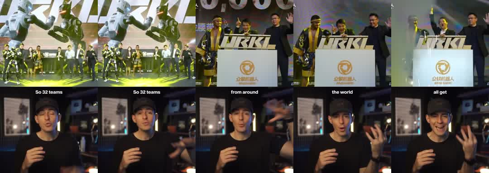

# v18_s11 · split_broll · 20.9–23.5s (calidad 3)

- **Guion:** So 32 teams from around the world all get identical
- **Qué se ve:** Split. Arriba evento de presentación: robots y personas en un escenario con luces verdes; a los 22.0 rueda de prensa con atril «URKL» y un boxeador con bata. Subtítulos «So 32 teams / from around / the world / all get».
- **Diseño:** Pantalla dividida (costura en y≈49.8% del alto): arriba video real a sangre (recortado a ~9:8), abajo él en plano medio. Subtítulo pequeño: sans geométrica bold (tipo Aeonik/Satoshi bold), blanco #FFFFFF, minúsculas tipo frase, ≈30 px de cuerpo sobre 720 px de ancho (bloque de 22 px de alto), centrado en X, 1–3 palabras por bloque justo bajo la costura (centro y≈54 %).
- **Efectos:** B-roll sin grado visible común (cada clip conserva su color de origen); sin grano ni viñeta añadidos.
- **Animación:** Corte seco de entrada y salida; dentro, cortes secos entre clips cada ~0.6–2 s, sincronizados a palabra; movimiento propio del clip.
- **Por qué aquí:** «32 teams from around the world» → gente/equipos en el evento.
