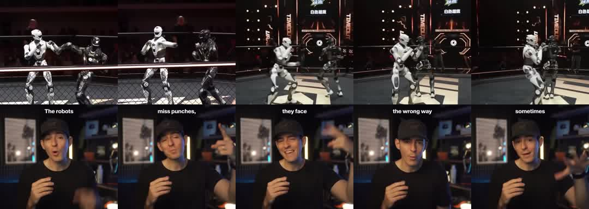

# v18_s22 · split_broll · 45.5–48.4s (calidad 3)

- **Guion:** The robots miss punches. They face the wrong way. Sometimes the
- **Qué se ve:** Split. Arriba robots fallando golpes en la jaula y luego mirando hacia el lado equivocado (rótulo «TIMEOUT» en el videomarcador). Subtítulos «The robots / miss punches, / they face / the wrong way».
- **Diseño:** Pantalla dividida (costura en y≈49.8% del alto): arriba video real a sangre (recortado a ~9:8), abajo él en plano medio. Subtítulo pequeño: sans geométrica bold (tipo Aeonik/Satoshi bold), blanco #FFFFFF, minúsculas tipo frase, ≈30 px de cuerpo sobre 720 px de ancho (bloque de 22 px de alto), centrado en X, 1–3 palabras por bloque justo bajo la costura (centro y≈54 %).
- **Efectos:** B-roll sin grado visible común (cada clip conserva su color de origen); sin grano ni viñeta añadidos.
- **Animación:** Corte seco de entrada y salida; dentro, cortes secos entre clips cada ~0.6–2 s, sincronizados a palabra; movimiento propio del clip.
- **Por qué aquí:** Cada fallo que nombra tiene su clip: «miss punches» / «face the wrong way» (humor por evidencia).
