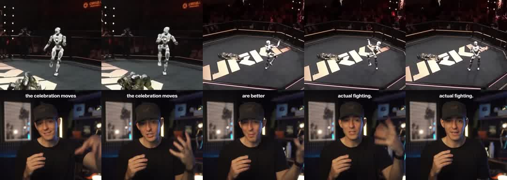

# v18_s23 · split_broll · 48.4–51.0s (calidad 4)

- **Guion:** celebration moves are better than the actual fighting. But
- **Qué se ve:** Split. Arriba un robot blanco bailando/celebrando solo y, a los 49.5, plano cenital del octágono «URKL» con un robot en el suelo y el otro celebrando. Subtítulos «sometimes / the celebration moves / are better / than the / actual fighting.»
- **Diseño:** Pantalla dividida (costura en y≈49.8% del alto): arriba video real a sangre (recortado a ~9:8), abajo él en plano medio. Subtítulo pequeño: sans geométrica bold (tipo Aeonik/Satoshi bold), blanco #FFFFFF, minúsculas tipo frase, ≈30 px de cuerpo sobre 720 px de ancho (bloque de 22 px de alto), centrado en X, 1–3 palabras por bloque justo bajo la costura (centro y≈54 %).
- **Efectos:** B-roll sin grado visible común (cada clip conserva su color de origen); sin grano ni viñeta añadidos.
- **Animación:** Corte seco de entrada y salida; dentro, cortes secos entre clips cada ~0.6–2 s, sincronizados a palabra; movimiento propio del clip.
- **Por qué aquí:** «celebration moves» → baile del robot: remate cómico del bloque.
