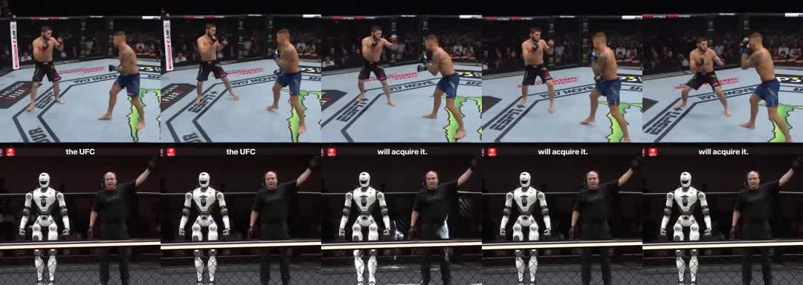

# v18_s27 · split_broll · 57.2–58.6s (calidad 5)

- **Guion:** UFC will acquire it.
- **Qué se ve:** Split SIN él: arriba pelea real de UFC (dos peleadores humanos en el octágono); abajo, en lugar de su plano, un robot blanco con un árbitro levantándole el brazo. Subtítulos «the UFC / will acquire it.»
- **Diseño:** Pantalla dividida 50/50 donde AMBAS mitades son b-roll (arriba UFC, abajo robot + árbitro); el subtítulo blanco pequeño sigue en y≈53 %, bajo la costura.
- **Efectos:** B-roll sin grado visible común (cada clip conserva su color de origen); sin grano ni viñeta añadidos.
- **Animación:** Corte seco de entrada (57.16) y salida (58.56); cada mitad con su propio clip en movimiento.
- **Por qué aquí:** «UFC will acquire it» → yuxtapone UFC humano (arriba) y robot (abajo): la pantalla dividida se convierte en comparación A/B.
