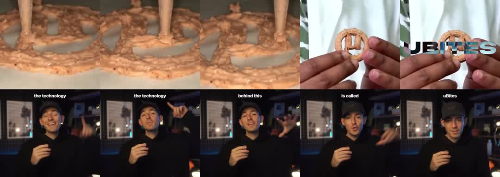

# v19_s06 · split_broll · 9.2–11.3s (calidad 5)

- **Guion:** The technology behind this is called uBites.
- **Qué se ve:** Split. Arriba macro de la extrusora y, desde 10.3, una mano sosteniendo la galleta con el rótulo 3D «UBITES» cruzando por detrás/delante de la galleta. Subtítulos «the technology / behind this / is called / uBites».
- **Diseño:** Pantalla dividida (costura en y≈50.3% del alto): arriba video real a sangre (recortado a ~9:8), abajo él en plano medio. Subtítulo pequeño: sans geométrica bold (tipo Aeonik/Satoshi bold), blanco #FFFFFF, minúsculas tipo frase, ≈30 px de cuerpo sobre 720 px de ancho (bloque de 22 px de alto), centrado en X, 1–3 palabras por bloque justo bajo la costura (centro y≈54 %).
- **Efectos:** B-roll sin grado visible común (cada clip conserva su color de origen); sin grano ni viñeta añadidos.
- **Animación:** Corte seco de entrada y salida; dentro, cortes secos entre clips cada ~0.6–2 s, sincronizados a palabra; movimiento propio del clip. Rótulo UBITES: aparece en ≈4 fotogramas (10.89–11.05) y queda fijo hasta 11.30.
- **Por qué aquí:** Nombre de la tecnología → rótulo con el nombre integrado en el plano (detrás de la galleta).
