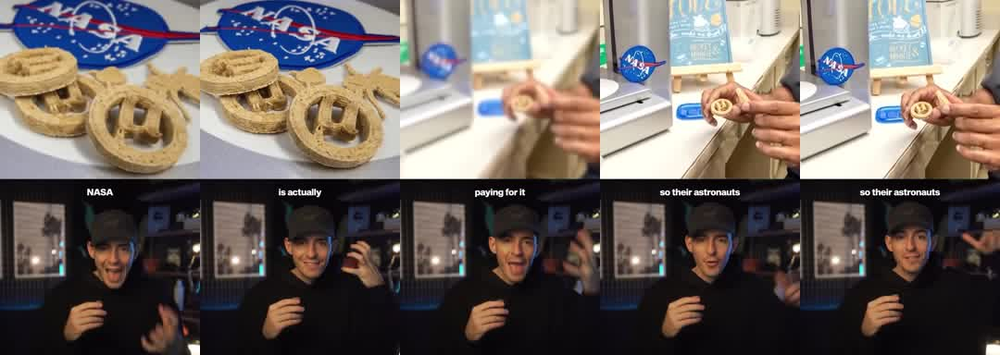

# v19_s08 · split_broll · 12.5–15.5s (calidad 3)

- **Guion:** NASA is actually paying for it. So their astronauts can
- **Qué se ve:** Split. Arriba galletas «μ» junto a un parche de la NASA y, desde 14.0, una mano con la galleta en un laboratorio con pegatina NASA. Subtítulos «NASA / is actually / paying for it / so their astronauts».
- **Diseño:** Pantalla dividida (costura en y≈50.3% del alto): arriba video real a sangre (recortado a ~9:8), abajo él en plano medio. Subtítulo pequeño: sans geométrica bold (tipo Aeonik/Satoshi bold), blanco #FFFFFF, minúsculas tipo frase, ≈30 px de cuerpo sobre 720 px de ancho (bloque de 22 px de alto), centrado en X, 1–3 palabras por bloque justo bajo la costura (centro y≈54 %).
- **Efectos:** B-roll sin grado visible común (cada clip conserva su color de origen); sin grano ni viñeta añadidos.
- **Animación:** Corte seco de entrada y salida; dentro, cortes secos entre clips cada ~0.6–2 s, sincronizados a palabra; movimiento propio del clip.
- **Por qué aquí:** «NASA» → logo de NASA junto al producto: autoridad institucional en la imagen.
