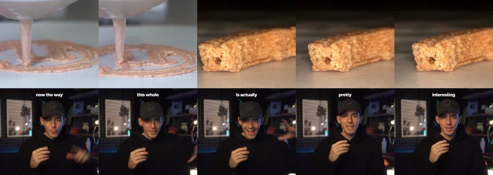

# v19_s12 · split_broll · 19.5–22.1s (calidad 3)

- **Guion:** Now the way this whole thing works is actually pretty interesting.
- **Qué se ve:** Split. Arriba boquilla imprimiendo y luego macro de un cordón de galleta con textura porosa. Subtítulos «now the way / this whole / is actually / interesting».
- **Diseño:** Pantalla dividida (costura en y≈50.3% del alto): arriba video real a sangre (recortado a ~9:8), abajo él en plano medio. Subtítulo pequeño: sans geométrica bold (tipo Aeonik/Satoshi bold), blanco #FFFFFF, minúsculas tipo frase, ≈30 px de cuerpo sobre 720 px de ancho (bloque de 22 px de alto), centrado en X, 1–3 palabras por bloque justo bajo la costura (centro y≈54 %).
- **Efectos:** B-roll sin grado visible común (cada clip conserva su color de origen); sin grano ni viñeta añadidos.
- **Animación:** Corte seco de entrada y salida; dentro, cortes secos entre clips cada ~0.6–2 s, sincronizados a palabra; movimiento propio del clip.
- **Por qué aquí:** Transición al «cómo funciona» con imágenes del proceso mientras lo anuncia.
