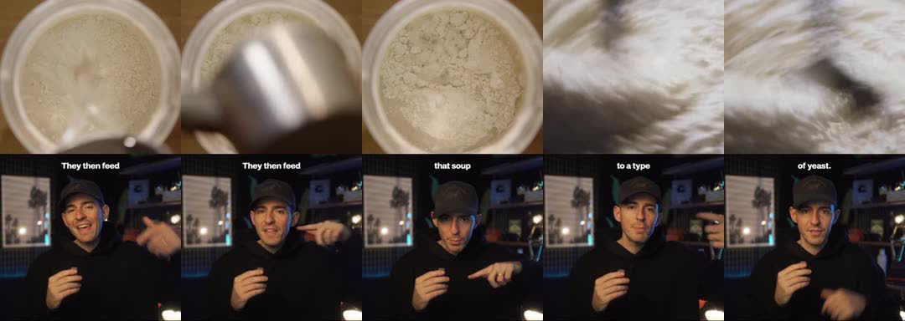

# v19_s19 · split_broll · 36.5–39.3s (calidad 3)

- **Guion:** They then feed that soup to a type of yeast.
- **Qué se ve:** Split (la costura sube a y≈48 %). Arriba un tarro con polvo beige visto desde arriba y una cuchara metálica; luego macro de masa/harina removida con cortes muy rápidos. Subtítulos «They then feed / that soup / to a type / of yeast.»
- **Diseño:** Pantalla dividida (costura en y≈47.9% del alto): arriba video real a sangre (recortado a ~9:8), abajo él en plano medio. Subtítulo pequeño: sans geométrica bold (tipo Aeonik/Satoshi bold), blanco #FFFFFF, minúsculas tipo frase, ≈30 px de cuerpo sobre 720 px de ancho (bloque de 22 px de alto), centrado en X, 1–3 palabras por bloque justo bajo la costura (centro y≈54 %).
- **Efectos:** B-roll sin grado visible común (cada clip conserva su color de origen); sin grano ni viñeta añadidos.
- **Animación:** Corte seco de entrada y salida; dentro, cortes secos entre clips cada ~0.6–2 s, sincronizados a palabra; movimiento propio del clip.
- **Por qué aquí:** «feed that soup to yeast» → levadura en polvo / masa: literal.
