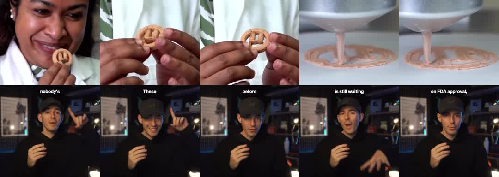

# v19_s40 · split_broll · 84.2–89.7s (calidad 3)

- **Guion:** Nobody's ever taste tested these plastic cookies before. The taste test is still waiting on FDA approval.
- **Qué se ve:** Split. Arriba la científica oliendo la galleta, dedos sosteniéndola y la boquilla imprimiendo. Subtítulos «nobody's / ever taste / tested / these / plastic cookies / before / the taste test / is still waiting / on FDA approval,».
- **Diseño:** Pantalla dividida (costura en y≈47.9% del alto): arriba video real a sangre (recortado a ~9:8), abajo él en plano medio. Subtítulo pequeño: sans geométrica bold (tipo Aeonik/Satoshi bold), blanco #FFFFFF, minúsculas tipo frase, ≈30 px de cuerpo sobre 720 px de ancho (bloque de 22 px de alto), centrado en X, 1–3 palabras por bloque justo bajo la costura (centro y≈54 %).
- **Efectos:** B-roll sin grado visible común (cada clip conserva su color de origen); sin grano ni viñeta añadidos.
- **Animación:** Corte seco de entrada y salida; dentro, cortes secos entre clips cada ~0.6–2 s, sincronizados a palabra; movimiento propio del clip.
- **Por qué aquí:** «Nobody's ever taste tested» → la científica solo la huele: la imagen confirma la pega.
