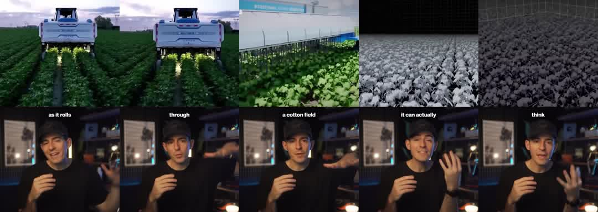

# v20_s03 · split_broll · 4.7–7.1s (calidad 3)

- **Guion:** As it rolls through a cotton field, it can actually think on
- **Qué se ve:** Split. Arriba la máquina real avanzando por un campo de algodón vista desde atrás, luego un plano lateral de la estructura sobre las plantas y un campo 3D que pasa de blanco a gris oscuro. Subtítulos «as it rolls / a cotton field / it can actually».
- **Diseño:** Pantalla dividida (costura en y≈50.3% del alto): arriba video real a sangre (recortado a ~9:8), abajo él en plano medio. Subtítulo pequeño: sans geométrica bold (tipo Aeonik/Satoshi bold), blanco #FFFFFF, minúsculas tipo frase, ≈30 px de cuerpo sobre 720 px de ancho (bloque de 22 px de alto), centrado en X, 1–3 palabras por bloque justo bajo la costura (centro y≈54 %).
- **Efectos:** B-roll sin grado visible común (cada clip conserva su color de origen); sin grano ni viñeta añadidos.
- **Animación:** Corte seco de entrada y salida; dentro, cortes secos entre clips cada ~0.6–2 s, sincronizados a palabra; movimiento propio del clip.
- **Por qué aquí:** «As it rolls through a cotton field» → la máquina rodando: literal; el paso a 3D prepara el «think».
