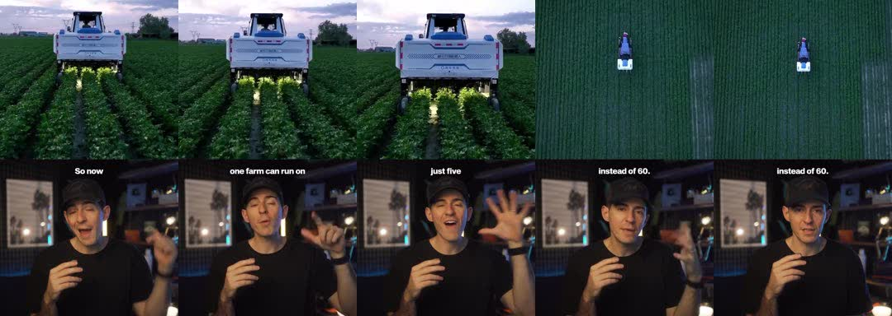

# v20_s34 · split_broll · 68.1–71.7s (calidad 4)

- **Guion:** So now one farm can run on just five employees instead of 60.
- **Qué se ve:** Split. Arriba la máquina real avanzando por el campo al anochecer (vista trasera, luces bajo el chasis) y luego un aéreo cenital. Subtítulos «So now / one farm can run on / just five / employees / instead of 60.»
- **Diseño:** Pantalla dividida (costura en y≈50.3% del alto): arriba video real a sangre (recortado a ~9:8), abajo él en plano medio. Subtítulo pequeño: sans geométrica bold (tipo Aeonik/Satoshi bold), blanco #FFFFFF, minúsculas tipo frase, ≈30 px de cuerpo sobre 720 px de ancho (bloque de 22 px de alto), centrado en X, 1–3 palabras por bloque justo bajo la costura (centro y≈54 %).
- **Efectos:** B-roll sin grado visible común (cada clip conserva su color de origen); sin grano ni viñeta añadidos.
- **Animación:** Corte seco de entrada y salida; dentro, cortes secos entre clips cada ~0.6–2 s, sincronizados a palabra; movimiento propio del clip.
- **Por qué aquí:** Consecuencia económica con la máquina real (no render): aterriza la promesa.
