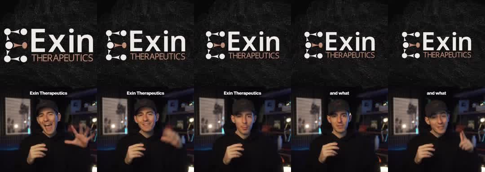

# v01_s14 · split_graphic · 14.0–15.4s (calidad 4)

- **Guion:** Therapeutics. And what they
- **Qué se ve:** Arriba: logo 'Exin THERAPEUTICS' (blanco y salmón) sobre fondo negro con textura. Subtítulo 'Exin Therapeutics'.
- **Diseño:** Pantalla dividida 50/50. Arriba logo 'Exin' en sans blanca grande + 'THERAPEUTICS' en salmón (#D99A86 aprox.) con isotipo de nodos, sobre negro texturizado. Subtítulo blanco, sans geométrica bold en minúsculas/caja normal (tipo Gilroy/Satoshi; fuente exacta desconocida), 1–3 palabras, centrado en x=50 %, centro en y≈54 % (≈692 px de 1280), altura de minúscula+ascendente ≈22 px (≈1.7 % del alto), sombra suave oscura.
- **Efectos:** Fondo negro con textura rugosa tipo asfalto/grano grueso.
- **Animación:** Corte seco; el logo hace un zoom-out lento (≈10 % en 0.5 s).
- **Por qué aquí:** Nombra la empresa y muestra su logo en la misma palabra.
