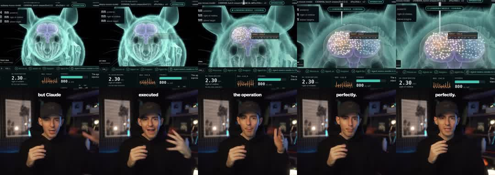

# v01_s29 · split_graphic · 49.5–51.9s (calidad 5)

- **Guion:** Claude executed the operation perfectly.
- **Qué se ve:** Arriba: rayos X frontal de la cabeza del ratón; zoom continuo hasta el cerebro con puntos naranjas y línea de aguja bajando ('LOWERING NEEDLE'). Subtítulo 'but Claude' / 'executed' / 'the operation' / 'perfectly.'.
- **Diseño:** Pantalla dividida 50/50. Arriba gráfico/animación sobre fondo oscuro verde-azulado: render tipo rayos X en cian (#7FE3D8 aprox.), puntos naranjas (#F08A3C aprox.) y lecturas monoespaciadas. Abajo él en plano medio. Subtítulo blanco, sans geométrica bold en minúsculas/caja normal (tipo Gilroy/Satoshi; fuente exacta desconocida), 1–3 palabras, centrado en x=50 %, centro en y≈54 % (≈692 px de 1280), altura de minúscula+ascendente ≈22 px (≈1.7 % del alto), sombra suave oscura.
- **Efectos:** Glow en puntos y líneas del gráfico; sin grano ni viñeta añadidos.
- **Animación:** Corte seco de entrada. El gráfico tiene movimiento propio (zoom de cámara virtual, puntos que se encienden, lecturas que cambian).
- **Por qué aquí:** Ejecución de la operación → animación de la aguja entrando.
