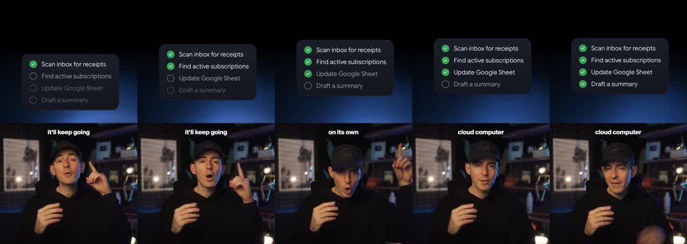

# v02_s20 · split_graphic · 33.2–35.5s (calidad 5)

- **Guion:** it'll keep going on its own cloud computer,
- **Qué se ve:** Arriba: tarjeta oscura con lista de cuatro pasos ('Scan inbox for receipts', 'Find active subscriptions', 'Update Google Sheet', 'Draft a summary') cuyos círculos se van marcando en verde uno a uno. Subtítulo 'it'll keep going' / 'on its own' / 'cloud computer'.
- **Diseño:** Pantalla dividida 50/50. Arriba motion graphic sobre negro (tarjeta, logos o iconos). Abajo él en plano medio. Subtítulo blanco, sans geométrica bold (fuente exacta desconocida), 1–3 palabras, centrado en x=50 %, y≈54 % (justo bajo la costura), altura ≈22 px sobre 1280, sombra suave.
- **Efectos:** Fondo negro puro; iconos y logos con sus colores de marca.
- **Animación:** Corte seco de entrada; el gráfico se anima (checks que se marcan, logos que suben con desenfoque de movimiento, iconos que se apilan).
- **Por qué aquí:** 'Sigue trabajando solo' → lista que se completa sola.
