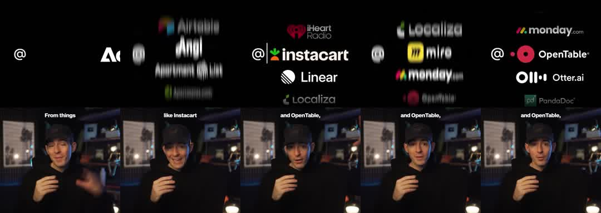

# v02_s25 · split_graphic · 42.1–43.9s (calidad 5)

- **Guion:** From things like Instacart and OpenTable to
- **Qué se ve:** Arriba: sobre negro aparece '@' y un muro de logos que sube rápido con desenfoque de movimiento (Adobe, Airtable, Angi, Canva, Dropbox, iHeartRadio, Instacart, Linear, monday.com, OpenTable, Otter.ai…). Subtítulo 'From things' / 'like Instacart' / 'and OpenTable,'.
- **Diseño:** Pantalla dividida 50/50. Arriba motion graphic sobre negro (tarjeta, logos o iconos). Abajo él en plano medio. Subtítulo blanco, sans geométrica bold (fuente exacta desconocida), 1–3 palabras, centrado en x=50 %, y≈54 % (justo bajo la costura), altura ≈22 px sobre 1280, sombra suave.
- **Efectos:** Fondo negro puro; iconos y logos con sus colores de marca.
- **Animación:** Corte seco de entrada; el gráfico se anima (checks que se marcan, logos que suben con desenfoque de movimiento, iconos que se apilan).
- **Por qué aquí:** Nombra marcas → la lista se detiene justo en la marca nombrada.
