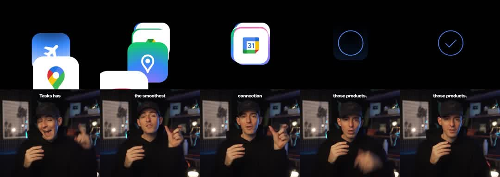

# v02_s30 · split_graphic · 48.2–51.4s (calidad 4)

- **Guion:** Task has the smoothest possible connection to all of those products.
- **Qué se ve:** Arriba: sobre negro, iconos de apps de Google como fichas redondeadas que se apilan y rotan (Gmail, teléfono, voz, Calendar); termina en un círculo con check. Subtítulo 'Tasks has' / 'the smoothest' / 'connection' / 'those products.'.
- **Diseño:** Pantalla dividida 50/50. Arriba motion graphic sobre negro (tarjeta, logos o iconos). Abajo él en plano medio. Subtítulo blanco, sans geométrica bold (fuente exacta desconocida), 1–3 palabras, centrado en x=50 %, y≈54 % (justo bajo la costura), altura ≈22 px sobre 1280, sombra suave.
- **Efectos:** Fondo negro puro; iconos y logos con sus colores de marca.
- **Animación:** Corte seco de entrada; el gráfico se anima (checks que se marcan, logos que suben con desenfoque de movimiento, iconos que se apilan).
- **Por qué aquí:** 'Conexión más fluida' → iconos encajando y check final.
