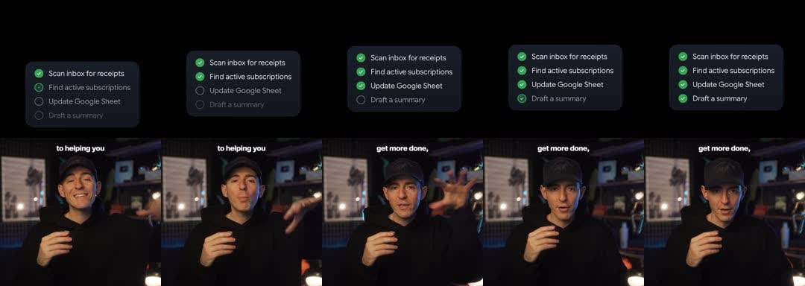

# v02_s52 · split_graphic · 79.4–80.7s (calidad 4)

- **Guion:** helping you get more done,
- **Qué se ve:** Arriba: checklist de cuatro pasos marcándose (repetido). Subtítulo 'to helping you' / 'get more done,'.
- **Diseño:** Pantalla dividida 50/50. Arriba motion graphic sobre negro (tarjeta, logos o iconos). Abajo él en plano medio. Subtítulo blanco, sans geométrica bold (fuente exacta desconocida), 1–3 palabras, centrado en x=50 %, y≈54 % (justo bajo la costura), altura ≈22 px sobre 1280, sombra suave.
- **Efectos:** Fondo negro puro; iconos y logos con sus colores de marca.
- **Animación:** Corte seco de entrada; el gráfico se anima (checks que se marcan, logos que suben con desenfoque de movimiento, iconos que se apilan).
- **Por qué aquí:** 'Hacer más' → checks.
