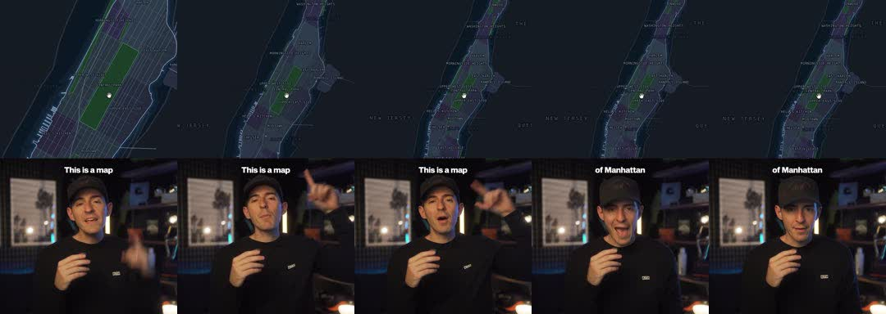

# v05_s06 · split_graphic · 8.3–10.0s (calidad 4)

- **Guion:** is a map of Manhattan.
- **Qué se ve:** Pantalla dividida. Arriba: mapa oscuro de Manhattan (estilo mapa vectorial azul noche) con Central Park en verde y un punto blanco.
- **Diseño:** Mapa azul noche (#141C2B aprox.), parque verde (#2E7D32 aprox.), barrios en morado tenue, rótulos en mono-espaciada mayúscula clara. Subtítulo blanco sans bold (tipo Inter/Helvetica Now), minúsculas con mayúscula inicial, 1–3 palabras, ~28 px sobre 720 (≈2,2 % del alto), centrado en x, y≈54 % (justo bajo la costura, que está en y≈50,4 %); sin caja sobre el A-roll oscuro
- **Efectos:** Set oscuro con luces prácticas cian y ámbar desenfocadas; sin textura añadida visible
- **Animación:** Corte seco de entrada y salida (1 fotograma); dentro, zoom-in lento (≈1.0→1.3 en 1,7 s)
- **Por qué aquí:** «This is a map of Manhattan»: literal. Baja el pulso tras el montaje y fija una referencia de escala conocida
