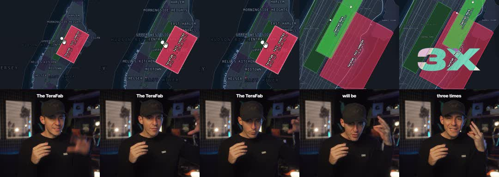

# v05_s07 · split_graphic · 10.0–11.4s (calidad 5)

- **Guion:** The TerraFab will be three times
- **Qué se ve:** Arriba: sobre el mapa cae un rectángulo rosa-rojo rotulado «Terafab, full complex · 10.25 km² · 110.3M sq ft» arrastrado por un cursor de mano; se coloca junto a Central Park.
- **Diseño:** Rectángulo rosa-rojo (#D6336C aprox.) girado ~30°, borde blanco fino, texto mono-espaciado blanco en negrita dentro. Rótulos de barrio (HARLEM, MIDTOWN…) en mayúsculas espaciadas. Subtítulo blanco sans bold (tipo Inter/Helvetica Now), minúsculas con mayúscula inicial, 1–3 palabras, ~28 px sobre 720 (≈2,2 % del alto), centrado en x, y≈54 % (justo bajo la costura, que está en y≈50,4 %); sin caja sobre el A-roll oscuro
- **Efectos:** Set oscuro con luces prácticas cian y ámbar desenfocadas; sin textura añadida visible
- **Animación:** El rectángulo entra en la palabra «TeraFab» (10.07 visible pequeño → tamaño final en ~5 fotogramas), con cursor de mano blanca; sensación seca
- **Por qué aquí:** Dato comparativo: pone el objeto nuevo encima del conocido. El cursor hace que parezca una demo en vivo, no un gráfico
