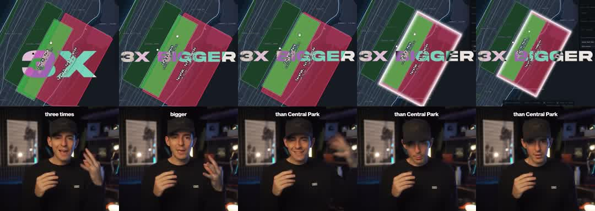

# v05_s08 · split_graphic · 11.4–13.3s (calidad 5)

- **Guion:** bigger than Central Park.
- **Qué se ve:** Arriba: zoom al parque (verde) superpuesto al rectángulo rojo; encima aparece «3X» en letras enormes turquesa/rosa y luego se abre a «3X BIGGER»; al final un contorno blanco rodea el rectángulo.
- **Diseño:** «3X»: sans extendida ultra pesada, relleno turquesa (#7FE3D0 aprox.) con sombra rosa/lila desplazada; luego «3X BIGGER» en una línea a todo el ancho, blanco/gris con letras intermedias en rosa. Contorno blanco grueso alrededor del rectángulo. Subtítulo blanco sans bold (tipo Inter/Helvetica Now), minúsculas con mayúscula inicial, 1–3 palabras, ~28 px sobre 720 (≈2,2 % del alto), centrado en x, y≈54 % (justo bajo la costura, que está en y≈50,4 %); sin caja sobre el A-roll oscuro
- **Efectos:** Efecto de duplicado cromático (turquesa/rosa) en las letras; Set oscuro con luces prácticas cian y ámbar desenfocadas; sin textura añadida visible
- **Animación:** «3X» entra con pop a 11.53 (≈ +0,17 s tras «three»), se mantiene ~0,5 s y a 12.07 se expande a «3X BIGGER» (coincide con «bigger»/«than»); contorno blanco se dibuja en 12.3–12.6; sale por corte a 13.26
- **Por qué aquí:** El número se dice y se ve a la vez: el dato comparativo queda como titular gráfico
