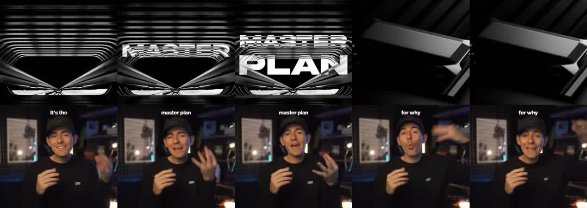

# v05_s13 · split_graphic · 21.7–23.6s (calidad 4)

- **Guion:** the master plan for why Elon
- **Qué se ve:** Arriba: túnel cromado en blanco y negro con bandas; el texto «MASTER PLAN» aparece en cromo/metal (21.69–22.90); luego un bloque negro brillante 3D (22.90–23.61).
- **Diseño:** «MASTER PLAN» en 2 líneas, mayúsculas, sans extendida ultra pesada con textura cromada/distorsionada, ocupa casi todo el ancho de la mitad superior. Subtítulo blanco sans bold (tipo Inter/Helvetica Now), minúsculas con mayúscula inicial, 1–3 palabras, ~28 px sobre 720 (≈2,2 % del alto), centrado en x, y≈54 % (justo bajo la costura, que está en y≈50,4 %); sin caja sobre el A-roll oscuro
- **Efectos:** Cromo líquido / bandas de alto contraste, distorsión en las letras
- **Animación:** «MASTER» entra a 22.0 (≈ +0,05 s tras «master»); «PLAN» a 22.3 y parpadea una vez (desaparece 2 fotogramas y vuelve); corte seco al prisma a 22.90
- **Por qué aquí:** Nombra el concepto central del video como si fuera un título de capítulo dentro de la mitad superior
