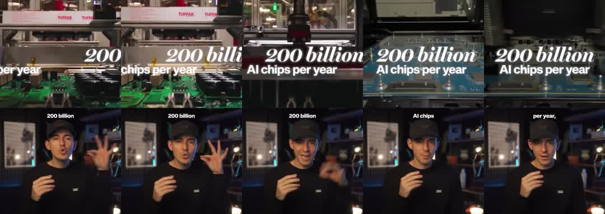

# v05_s31 · split_graphic · 61.9–64.4s (calidad 5)

- **Guion:** billion AI chips per year.
- **Qué se ve:** Arriba: b-roll de líneas de montaje de placas (3 planos: 61.85–63.19, 63.19–63.61, 63.61–64.40) con el texto «200 billion» (serif itálica) y «AI chips per year» (sans bold) deslizándose desde la derecha hasta el centro.
- **Diseño:** «200 billion» en serif itálica bold blanca (~48 px), «AI chips per year» en sans bold blanca (~34 px) debajo; ambas con sombra/glow; centradas en la mitad superior (y≈28–32 %). Subtítulo blanco sans bold (tipo Inter/Helvetica Now), minúsculas con mayúscula inicial, 1–3 palabras, ~28 px sobre 720 (≈2,2 % del alto), centrado en x, y≈54 % (justo bajo la costura, que está en y≈50,4 %); sin caja sobre el A-roll oscuro
- **Efectos:** Sombra suave bajo el texto; b-roll con verdes y grises de fábrica
- **Animación:** El texto entra con slide desde la derecha a 61.92 (≈ +0,24 s tras «200»): la línea 1 va por delante y la 2 llega desde la izquierda; centrado a ≈63.0; se mantiene mientras cambian 3 planos debajo; sale por corte a 64.40
- **Por qué aquí:** La cifra clave del video recibe tratamiento de titular: itálica para el número, sans para la unidad
