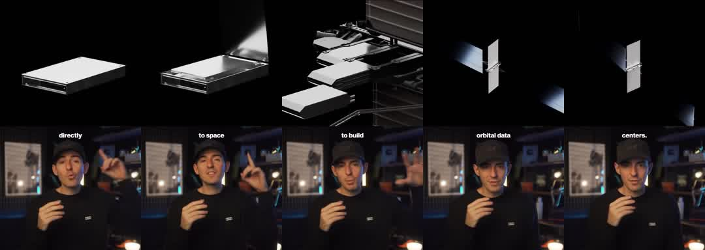

# v05_s33 · split_graphic · 65.5–68.3s (calidad 4)

- **Guion:** to space to build orbital data centers.
- **Qué se ve:** Arriba: sobre negro, una losa blanca 3D (servidor) entra y se despliega en capas (65.52–66.78), plano de piezas desplegadas (66.78–67.28) y un satélite blanco con paneles girando (67.28–68.32).
- **Diseño:** Subtítulo blanco sans bold (tipo Inter/Helvetica Now), minúsculas con mayúscula inicial, 1–3 palabras, ~28 px sobre 720 (≈2,2 % del alto), centrado en x, y≈54 % (justo bajo la costura, que está en y≈50,4 %); sin caja sobre el A-roll oscuro
- **Efectos:** Blanco puro sobre negro puro, sin color
- **Animación:** Corte seco de entrada y salida (1 fotograma); la losa entra subiendo en ~0,3 s y se despliega con movimiento continuo
- **Por qué aquí:** «Sent directly to space to build orbital data centers»: visualiza un concepto que no tiene metraje real
