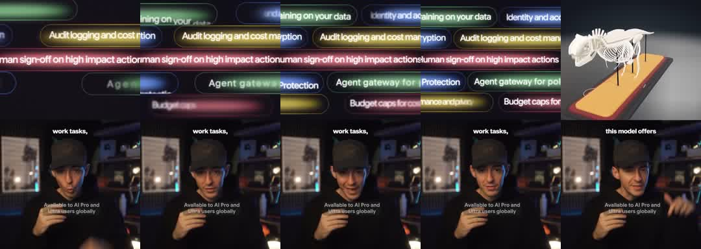

# v06_s04 · split_graphic · 4.6–5.3s (calidad 3)

- **Guion:** tasks,
- **Qué se ve:** Arriba: fondo negro con pastillas de contorno luminoso de colores («Audit logging and cost management», «Human sign-off on high impact actions», «Agent gateway for policy»…) desplazándose.
- **Diseño:** Pastillas redondeadas con borde neón amarillo/rojo/verde/azul y texto blanco sans regular; Subtítulo blanco sans bold (tipo Inter), 1–3 palabras, ~30 px sobre 720 (≈2,3 % del alto), centrado, y≈52,7 % (≈58 px bajo la costura, que está en y≈48,1 %); sin caja. Sobre su pecho, texto legal gris semitransparente en 2 líneas «Available to AI Pro and Ultra users globally» (y≈83 %, sans regular ~24 px).
- **Efectos:** Glow de neón, desenfoque en los bordes
- **Animación:** Corte seco de entrada y salida (1 fotograma); dentro las pastillas aparecen con fundido escalonado
- **Por qué aquí:** «Work tasks» → lista de tareas empresariales en pantalla
