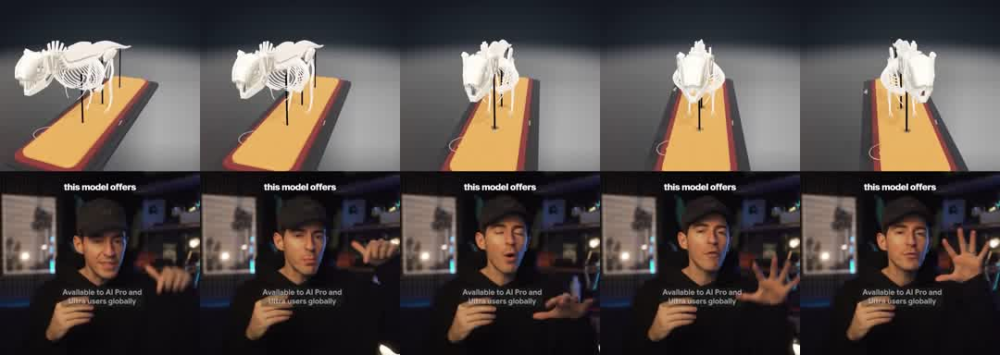

# v06_s05 · split_graphic · 5.3–6.2s (calidad 3)

- **Guion:** this model offers frontier
- **Qué se ve:** Arriba: modelo 3D blanco de un esqueleto animal sobre una base naranja, girando.
- **Diseño:** Subtítulo blanco sans bold (tipo Inter), 1–3 palabras, ~30 px sobre 720 (≈2,3 % del alto), centrado, y≈52,7 % (≈58 px bajo la costura, que está en y≈48,1 %); sin caja. Sobre su pecho, texto legal gris semitransparente en 2 líneas «Available to AI Pro and Ultra users globally» (y≈83 %, sans regular ~24 px).
- **Efectos:** Set oscuro con luces cian y ámbar desenfocadas; sin textura añadida
- **Animación:** Corte seco de entrada y salida (1 fotograma)
- **Por qué aquí:** «This model offers» → muestra una salida del modelo (3D)
