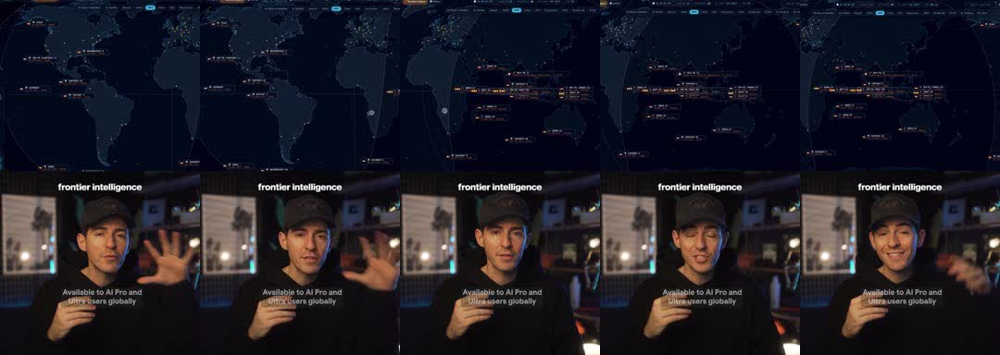

# v06_s06 · split_graphic · 6.2–7.4s (calidad 2)

- **Guion:** intelligence to
- **Qué se ve:** Arriba: mapa del mundo oscuro con puntos y etiquetas (panel de datos).
- **Diseño:** Subtítulo blanco sans bold (tipo Inter), 1–3 palabras, ~30 px sobre 720 (≈2,3 % del alto), centrado, y≈52,7 % (≈58 px bajo la costura, que está en y≈48,1 %); sin caja. Sobre su pecho, texto legal gris semitransparente en 2 líneas «Available to AI Pro and Ultra users globally» (y≈83 %, sans regular ~24 px).
- **Efectos:** Set oscuro con luces cian y ámbar desenfocadas; sin textura añadida
- **Animación:** Corte seco de entrada y salida (1 fotograma)
- **Por qué aquí:** «Frontier intelligence» → escala global
