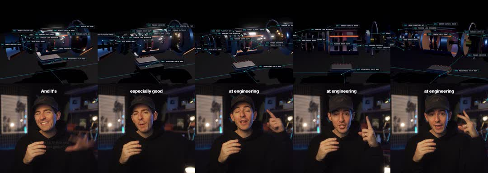

# v06_s08 · split_graphic · 8.7–10.3s (calidad 3)

- **Guion:** And it's especially good at engineering and
- **Qué se ve:** Arriba: diagrama 3D oscuro de una máquina/línea industrial con etiquetas flotantes.
- **Diseño:** Subtítulo blanco sans bold (tipo Inter), 1–3 palabras, ~30 px sobre 720 (≈2,3 % del alto), centrado, y≈52,7 % (≈58 px bajo la costura, que está en y≈48,1 %); sin caja. El texto legal se desvanece (≈8.7–9.1)
- **Efectos:** Set oscuro con luces cian y ámbar desenfocadas; sin textura añadida
- **Animación:** Corte seco de entrada y salida (1 fotograma)
- **Por qué aquí:** «Especially good at engineering» → ingeniería literal
