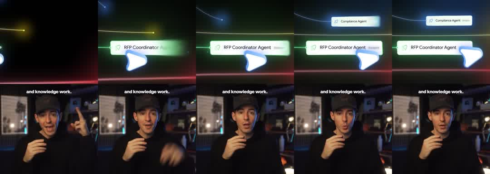

# v06_s09 · split_graphic · 10.3–11.2s (calidad 3)

- **Guion:** knowledge work.
- **Qué se ve:** Arriba: nodo «RFP Coordinator Agent» con una flecha azul y líneas de luz de colores; aparece otro nodo «Compliance Agent».
- **Diseño:** Subtítulo blanco sans bold (tipo Inter), 1–3 palabras, ~30 px sobre 720 (≈2,3 % del alto), centrado, y≈52,7 % (≈58 px bajo la costura, que está en y≈48,1 %); sin caja
- **Efectos:** Líneas de luz roja/verde/amarilla con glow
- **Animación:** Corte seco; el nodo aparece con fundido+barrido en ~4 fotogramas
- **Por qué aquí:** «Knowledge work» → agentes de oficina (RFP)
