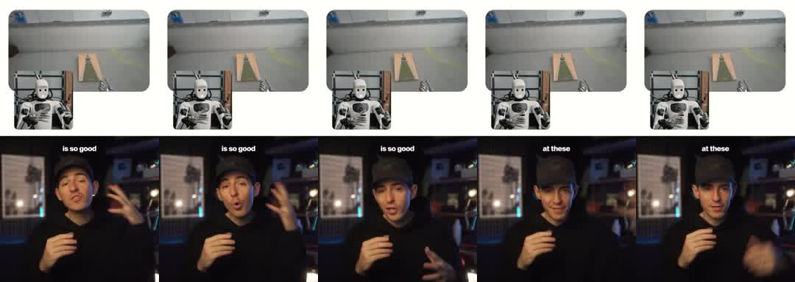

# v06_s11 · split_graphic · 12.5–13.6s (calidad 2)

- **Guion:** so good at these complex
- **Qué se ve:** Arriba: fondo blanco con dos tarjetas redondeadas: simulación de un tablero de cornhole y un robot humanoide.
- **Diseño:** Subtítulo blanco sans bold (tipo Inter), 1–3 palabras, ~30 px sobre 720 (≈2,3 % del alto), centrado, y≈52,7 % (≈58 px bajo la costura, que está en y≈48,1 %); sin caja
- **Efectos:** Set oscuro con luces cian y ámbar desenfocadas; sin textura añadida
- **Animación:** Corte seco de entrada y salida (1 fotograma)
- **Por qué aquí:** «So good at these» → prepara el ejemplo del robot
