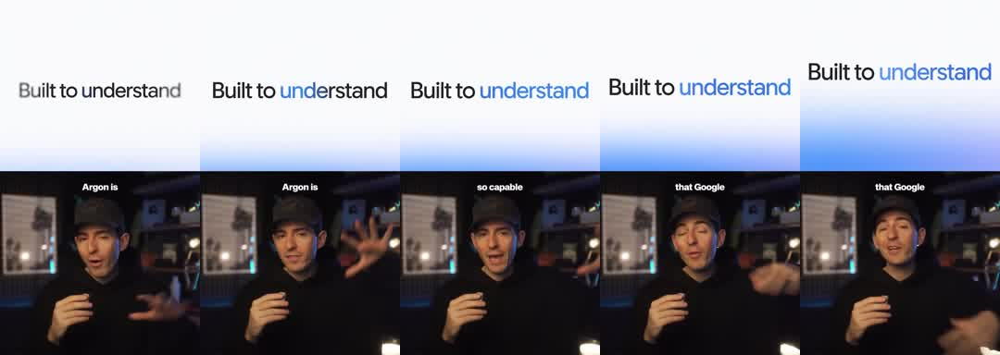

# v06_s30 · split_graphic · 53.0–54.2s (calidad 2)

- **Guion:** Argonne is so capable that Google
- **Qué se ve:** Arriba: fondo blanco con el texto «Built to understand» («understand» pasa de gris a azul).
- **Diseño:** Sans regular grande gris oscuro + azul Google (#1A73E8 aprox.), centrado. Subtítulo blanco sans bold (tipo Inter), 1–3 palabras, ~30 px sobre 720 (≈2,3 % del alto), centrado, y≈52,7 % (≈58 px bajo la costura, que está en y≈48,1 %); sin caja
- **Efectos:** Set oscuro con luces cian y ámbar desenfocadas; sin textura añadida
- **Animación:** Corte seco; fundido de gris a azul en ~0,3 s
- **Por qué aquí:** «So capable» → eslogan oficial del producto
